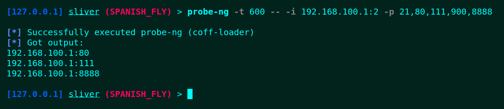

# Probe-NG  
  
An improved version of TrustedSec's classic sa-probe BOF.  
Want fast in-memory port scanning? Use Probe-NG!  
  
<b>Highlights:</b>  
• Works with Sliver.  
• Accepts lists and ranges of ports and IPs.  
• Well-formatted output. Pretty!  
  
<b>Installation:</b>  
1. Run `sudo apt-get install -y mingw-w64`  
2. Run `./mkbof`  
3. If using Sliver, run `extensions load /home/[user]/.sliver-client/extensions/probe-ng`  
  
<b>Usage:</b>  
`probe-ng (flags) -- -i [IP(s)] -p [port(s)]`  
  
Use ":" to separate ranges and "," to separate lists.  
Singular ports or IPs can be used as well, as with the original sa-probe.  
  
Note: "(flags)" refers to Sliver's usual set of execution flags, such `-t [timeout]`.  
  
<b>Examples:</b>  

